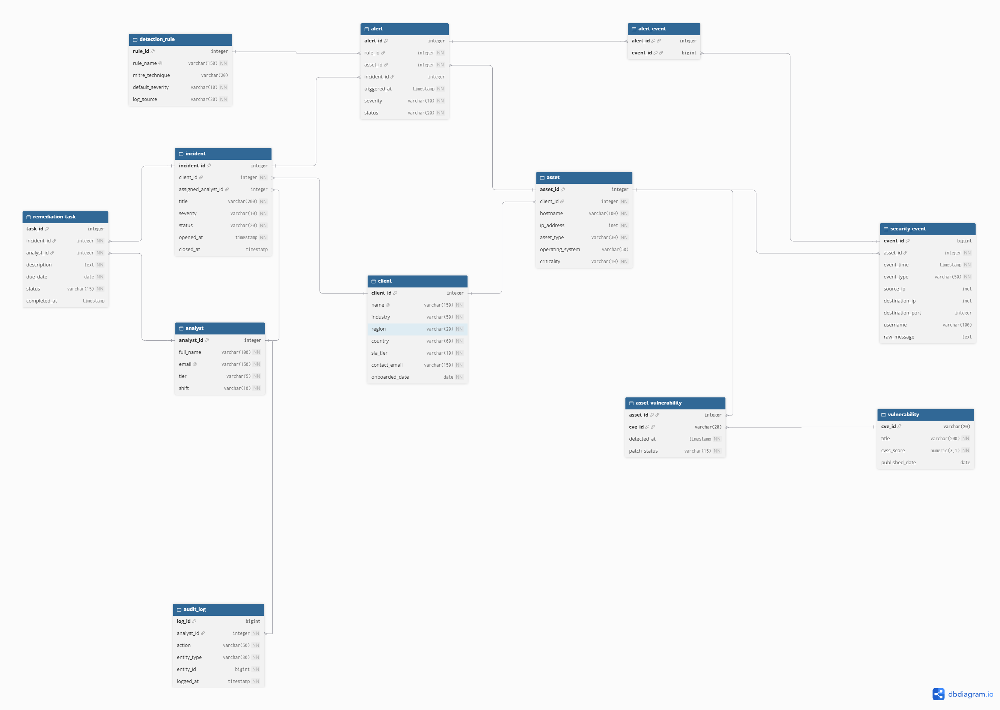

# Portfolio 1 — Database Design and Modelling

**Course:** MIT 8103 Advanced Database Systems
**Case study:** CyberAce Tech Security Ltd — SOC Security Alert and Incident Management System

---

## 1. Case Study Statement

### Organisation / scenario
**CyberAce Tech Security Ltd** is a simulated global Managed Security Service Provider (MSSP) headquartered in Lagos, Nigeria, monitoring clients across Africa, Europe and the Middle East. It runs a 24/7 Security Operations Centre (SOC) that monitors the IT infrastructure of client organisations — such as banks, fintechs, hospitals and e-commerce companies — for cyber threats. All clients, assets and data in this portfolio are simulated.

### Nature of the business / system
Client devices (servers, workstations, firewalls, cloud workloads) continuously send security logs to the SOC. Detection rules analyse these logs and raise **alerts** when suspicious activity is found (e.g. brute-force logins, malware beacons, port scans). Analysts triage alerts, group related alerts into **incidents**, investigate them, and assign **remediation tasks** until the threat is resolved. The SOC also tracks known **vulnerabilities (CVEs)** on each client asset.

The database is the system of record for all of this activity.

### Users of the database
| User | What they do |
|---|---|
| L1 SOC Analysts | Triage new alerts, mark false positives, escalate |
| L2/L3 Analysts (Incident Responders) | Investigate incidents, assign and complete remediation tasks |
| SOC Manager | Monitors workload, SLA compliance and reporting |
| Client Security Contacts | View incidents and vulnerabilities affecting their own assets (read-only) |
| Auditors / Compliance | Review the audit trail of analyst actions (e.g. for NDPA compliance) |

### Major data to be stored
- Clients and their SLA tier
- Assets (hostname, IP address, type, criticality)
- Raw security events / logs (high volume)
- Detection rules (mapped to MITRE ATT&CK techniques)
- Alerts and incidents
- Analysts and their tier
- Vulnerabilities (CVEs) and which assets they affect
- Remediation tasks
- Audit log of analyst actions

### Key operations the database supports
1. Ingest security events from client assets
2. Raise an alert when an event matches a detection rule
3. Triage alerts (open → investigating → false positive / escalated)
4. Create an incident and link related alerts to it
5. Assign an incident to an analyst (only one analyst may claim it)
6. Create, assign and close remediation tasks
7. Record vulnerabilities detected on assets and track patch status
8. Report: top attacking IPs, alerts per client, mean time to resolve (MTTR), SLA breaches
9. Record every analyst action in an audit log

### Why this case study supports all five portfolio activities
| Portfolio | How the case study is used |
|---|---|
| 1. Design | Rich entities with 1:N and M:N relationships (assets ↔ vulnerabilities) |
| 2. Query optimisation | `security_event` holds 500k+ rows — indexing and partitioning make a measurable difference |
| 3. Transactions | Two analysts claiming the same incident (lost update); escalation must commit or roll back as one unit |
| 4. NoSQL | Raw logs with varying formats (MongoDB), attack-path graph (Neo4j), IP blocklist with expiry (Redis) |
| 5. Distributed / cloud | Clients in three regions (Africa, Europe, Middle East) — logs sharded by region/client; replication for 24/7 availability; CAP trade-offs |

---

## 2. Entities (first pass)

| Entity | Description | Primary key |
|---|---|---|
| `client` | Organisation monitored by the SOC | `client_id` |
| `asset` | A device or system owned by a client | `asset_id` |
| `analyst` | SOC staff member | `analyst_id` |
| `detection_rule` | Logic that turns events into alerts | `rule_id` |
| `security_event` | One raw log record from an asset | `event_id` |
| `alert` | Suspicious activity flagged by a rule | `alert_id` |
| `alert_event` | Links an alert to the events that triggered it (M:N) | (`alert_id`, `event_id`) |
| `incident` | A confirmed security issue grouping one or more alerts | `incident_id` |
| `vulnerability` | A known CVE | `cve_id` |
| `asset_vulnerability` | Which CVEs affect which assets (M:N) | (`asset_id`, `cve_id`) |
| `remediation_task` | Action required to resolve an incident | `task_id` |
| `audit_log` | Record of every analyst action | `log_id` |

## 3. Relationships

| Relationship | Cardinality | Notes |
|---|---|---|
| client → asset | 1 : N | Every asset belongs to exactly one client |
| client → incident | 1 : N | Incidents are raised per client |
| asset → security_event | 1 : N | Each event comes from one asset |
| detection_rule → alert | 1 : N | Each alert is raised by one rule |
| asset → alert | 1 : N | Each alert concerns one asset |
| alert ↔ security_event | M : N | Resolved by `alert_event` |
| incident → alert | 1 : N (optional) | An alert belongs to at most one incident; `alert.incident_id` may be NULL |
| analyst → incident | 1 : N (optional) | An incident may be unassigned |
| incident → remediation_task | 1 : N | |
| analyst → remediation_task | 1 : N | |
| asset ↔ vulnerability | M : N | Resolved by `asset_vulnerability` |
| analyst → audit_log | 1 : N | |

## 4. Key business rules (become constraints)

- Severity must be one of `Low`, `Medium`, `High`, `Critical` → `CHECK`
- CVSS score must be between 0.0 and 10.0 → `CHECK`
- An incident's `closed_at` must be after `opened_at` → `CHECK`
- A `Closed` incident must have a `closed_at` value → `CHECK`
- Analyst email and asset hostname-per-client must be unique → `UNIQUE`
- An asset cannot be deleted while it has events or alerts → `ON DELETE RESTRICT`
- Deleting an incident deletes its remediation tasks → `ON DELETE CASCADE`

---

## 5. ER Diagram

See [`erd.dbml`](erd.dbml). Paste it into https://dbdiagram.io to render, then export as `erd.png` into this folder.

## 6. Still to do in this portfolio
- [ ] `schema.sql` — CREATE TABLE statements with all keys and constraints
- [ ] Normalisation walkthrough (UNF → 1NF → 2NF → 3NF)
- [ ] Sample data insert and test that constraints reject bad data (screenshots)
