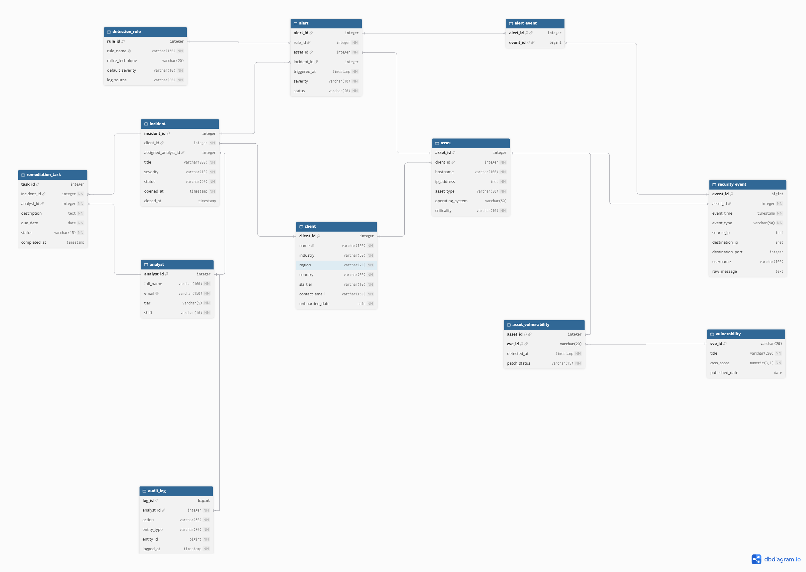

# Portfolio 1 — Database Design and Modelling

**Course:** MIT 8103 Advanced Database Systems
**Case study:** CyberAce Tech Security Ltd — SOC Security Alert and Incident Management System
**DBMS:** PostgreSQL (managed with pgAdmin 4)

---

## 1. Case Study Statement

### Organisation / scenario
**CyberAce Tech Security Ltd** is a simulated global Managed Security Service Provider (MSSP) headquartered in Lagos, Nigeria, monitoring clients across Africa, Europe and the Middle East. It runs a 24/7 Security Operations Centre (SOC) that monitors the IT infrastructure of client organisations — banks, fintechs, hospitals, logistics, energy and e-commerce companies — for cyber threats. The company and its clients are simulated; the threat-intelligence reference data is real (see Section 2).

### Nature of the business / system
Client devices (servers, workstations, firewalls, routers, cloud workloads) continuously send security logs to the SOC. CyberAce's **detection rules** — each mapped to a real **MITRE ATT&CK** technique — analyse these logs and raise **alerts** when suspicious activity is found. Analysts triage alerts, group related alerts into **incidents**, investigate them and assign **remediation tasks** until the threat is resolved. The SOC also tracks which **known exploited vulnerabilities** (from the CISA KEV catalog) are present on each client asset.

### Users of the database
| User | What they do |
|---|---|
| L1 SOC Analysts | Triage new alerts, mark false positives, escalate |
| L2/L3 Analysts (Incident Responders) | Investigate incidents, assign and complete remediation tasks |
| SOC Manager | Monitors workload, SLA compliance and reporting |
| Client Security Contacts | View incidents and vulnerabilities affecting their own assets (read-only) |
| Auditors / Compliance | Review the audit trail of analyst actions (e.g. for NDPA compliance) |

### Major data to be stored
- Clients, their region and SLA tier
- Assets (hostname, IP address, type, criticality)
- Raw security events / logs (high volume)
- Detection rules mapped to MITRE ATT&CK tactics and techniques
- Alerts and incidents
- Analysts and their tier
- Known exploited vulnerabilities (CVEs), their weakness types (CWEs) and which assets they affect
- Remediation tasks
- Audit log of analyst actions

### Key operations the database supports
1. Ingest security events from client assets
2. Raise an alert when an event matches a detection rule
3. Triage alerts (Open → Investigating → False Positive / Escalated)
4. Create an incident and link related alerts to it
5. Assign an incident to an analyst (only one analyst may claim it)
6. Create, assign and close remediation tasks
7. Record which known exploited CVEs are present on client assets and track patch status
8. Report on attacks by MITRE tactic, vulnerabilities used in ransomware, MTTR and SLA breaches
9. Record every analyst action in an audit log

### Why this case study supports all five portfolio activities
| Portfolio | How the case study is used |
|---|---|
| 1. Design | 16 tables, 1:N, M:N and self-referencing relationships, real reference data |
| 2. Query optimisation | `security_event` loaded with 600,000+ real log lines (Loghub OpenSSH) — indexing makes a measurable difference |
| 3. Transactions | Two analysts claiming the same incident (lost update); escalation must commit or roll back as one unit |
| 4. NoSQL | Raw logs with varying formats (MongoDB), MITRE attack paths as a graph (Neo4j), IP blocklist with expiry (Redis) |
| 5. Distributed / cloud | Clients in three regions — data sharded by region; replication for 24/7 availability; CAP trade-offs |

---

## 2. Data Sources — Real and Simulated

| Table(s) | Type | Source |
|---|---|---|
| `vulnerability`, `vulnerability_cwe` | **Real** | CISA Known Exploited Vulnerabilities (KEV) catalog — 1,779 CVEs (downloaded 11 Nov 2026) |
| `mitre_tactic`, `mitre_technique`, `technique_tactic` | **Real** | MITRE ATT&CK Enterprise v20.1 — 15 tactics, 227 techniques, 479 sub-techniques |
| `vulnerability.cvss_score` (7 CVEs on client assets) | **Real** | NIST National Vulnerability Database (NVD), CVSS v3.x base scores |
| `security_event` (bulk) | **Real** — *added in Portfolio 2* | Loghub OpenSSH server log (655,146 lines) |
| `client`, `analyst`, `asset`, `incident`, `alert`, `alert_event`, `remediation_task`, `audit_log`, `detection_rule`, sample events | **Simulated** | Created for this case study |

**Why some data is simulated:** real SOC client records (who the clients are, their assets, their incidents) are confidential and protected by data-protection law such as the Nigeria Data Protection Act 2023, so no public source exists. Simulated attacker IP addresses use the IETF documentation ranges (RFC 5737), and simulated email domains use the reserved `.example` domain, so no real organisation or address is implicated.

**How the real data was loaded:** see [`import_real_data.sql`](import_real_data.sql) and [`../data/README.md`](../data/README.md). The import follows an **ETL** process: raw CSV files are loaded into all-text *staging* tables, then transformed (type conversion, renaming, splitting multi-value cells) and loaded into the final tables inside one transaction.

---

## 3. Entities

| # | Entity | Description | Primary key | Data |
|---|---|---|---|---|
| 1 | `client` | Organisation monitored by the SOC | `client_id` | Simulated |
| 2 | `analyst` | SOC staff member | `analyst_id` | Simulated |
| 3 | `mitre_tactic` | Attacker's goal (e.g. Credential Access) | `tactic_id` | Real |
| 4 | `mitre_technique` | How the goal is achieved (e.g. T1110 Brute Force); sub-techniques point to a parent | `technique_id` | Real |
| 5 | `technique_tactic` | Links techniques to tactics (M:N) | (`technique_id`, `tactic_id`) | Real |
| 6 | `detection_rule` | CyberAce rule that turns events into alerts, mapped to a technique | `rule_id` | Simulated |
| 7 | `vulnerability` | Known exploited CVE | `cve_id` | Real |
| 8 | `vulnerability_cwe` | Weakness types of each CVE (M:N) | (`cve_id`, `cwe_id`) | Real |
| 9 | `asset` | Device or system owned by a client | `asset_id` | Simulated |
| 10 | `security_event` | One raw log record from an asset | `event_id` | Simulated (+ real in P2) |
| 11 | `incident` | Confirmed security issue grouping alerts | `incident_id` | Simulated |
| 12 | `alert` | Suspicious activity flagged by a rule | `alert_id` | Simulated |
| 13 | `alert_event` | Links an alert to the events that triggered it (M:N) | (`alert_id`, `event_id`) | Simulated |
| 14 | `asset_vulnerability` | Which CVEs affect which assets (M:N) | (`asset_id`, `cve_id`) | Simulated links to real CVEs |
| 15 | `remediation_task` | Action required to resolve an incident | `task_id` | Simulated |
| 16 | `audit_log` | Record of every analyst action | `log_id` | Simulated |

## 4. Relationships

| Relationship | Cardinality | Notes |
|---|---|---|
| client → asset | 1 : N | Every asset belongs to exactly one client |
| client → incident | 1 : N | Incidents are raised per client |
| asset → security_event | 1 : N | Each event comes from one asset |
| asset → alert | 1 : N | Each alert concerns one asset |
| alert ↔ security_event | M : N | Resolved by `alert_event` |
| detection_rule → alert | 1 : N | Each alert is raised by one rule |
| mitre_technique → detection_rule | 1 : N (optional) | Each rule maps to one ATT&CK technique |
| mitre_technique → mitre_technique | 1 : N (recursive) | A technique can have many sub-techniques |
| mitre_technique ↔ mitre_tactic | M : N | Resolved by `technique_tactic` (e.g. T1078 Valid Accounts serves 4 tactics) |
| vulnerability → vulnerability_cwe | 1 : N | One CVE can have several CWE weakness types |
| asset ↔ vulnerability | M : N | Resolved by `asset_vulnerability` |
| incident → alert | 1 : N (optional) | An alert belongs to at most one incident; `alert.incident_id` may be NULL |
| analyst → incident | 1 : N (optional) | An incident may be unassigned |
| incident → remediation_task | 1 : N | |
| analyst → remediation_task | 1 : N | |
| analyst → audit_log | 1 : N | |

## 5. Business Rules and Constraints

| Business rule | Constraint |
|---|---|
| Severity must be Low / Medium / High / Critical | `CHECK` |
| CVSS score must be between 0.0 and 10.0 | `CHECK chk_vuln_cvss` |
| CVE, CWE, tactic and technique IDs must follow their official formats | `CHECK` with regular expressions |
| A sub-technique must have a parent; a main technique must not | `CHECK chk_technique_parent` |
| An incident cannot close before it opened | `CHECK chk_incident_dates` |
| An incident is Closed **if and only if** it has a `closed_at` time | `CHECK chk_incident_closed` |
| A task is Done **if and only if** it has a `completed_at` time | `CHECK chk_task_done` |
| Port numbers must be 0–65535 | `CHECK chk_event_port` |
| IP addresses must be valid | PostgreSQL `INET` data type |
| Analyst emails are unique; hostnames are unique within a client | `UNIQUE` / composite `UNIQUE` |
| A client or asset with dependent records cannot be deleted | `FOREIGN KEY … ON DELETE RESTRICT` |
| A MITRE technique used by a detection rule cannot be deleted | `FOREIGN KEY … ON DELETE RESTRICT` |
| Deleting an incident deletes its tasks but keeps its alerts (unlinked) | `ON DELETE CASCADE` / `ON DELETE SET NULL` |

All rules are proven by [`constraint_tests.sql`](constraint_tests.sql) — 19 tests, each trying to insert or delete invalid data (see Section 9).

---

## 6. ER Diagram

The diagram shows the 16 tables of the CyberAce SOC database. Real reference data (MITRE ATT&CK and CISA KEV) sits on one side; CyberAce's simulated operational data on the other, joined through `detection_rule` and `asset_vulnerability`.
It was designed in DBML ([`erd.dbml`](erd.dbml)) and rendered with dbdiagram.io.



**Key design points:**
- `technique_tactic`, `vulnerability_cwe`, `alert_event` and `asset_vulnerability` are junction tables that resolve many-to-many relationships.
- `mitre_technique.parent_technique_id` is a self-referencing (recursive) foreign key linking sub-techniques to their parent technique.
- `alert.incident_id` is optional because new alerts are not yet linked to an incident.
- `client.region` supports regional sharding in Portfolio 5.

---

## 7. Normalisation

The design was checked step by step from an unnormalised form to Third Normal Form (3NF), using the case study's own data.

### Starting point — Unnormalised Form (UNF)
Imagine an L1 analyst tracking alerts in a single spreadsheet:

| alert_id | client | client_region | hostname | rule | technique | technique_name | tactics | cves_on_host | event_ids |
|---|---|---|---|---|---|---|---|---|---|
| 8 | Kestrel Pay Ltd | Africa | kp-api-gw01 | Impossible Travel Login | T1078 | Valid Accounts | Initial Access, Persistence, Privilege Escalation, Stealth | — | 57, 58 |
| 1 | Kestrel Pay Ltd | Africa | kp-vpn01 | Brute Force Login Attempts | T1110 | Brute Force | Credential Access | CVE-2024-21762 (9.8) | 1, 2, 3 … 25 |

Problems: cells with **several values** (`tactics`, `cves_on_host`, `event_ids`), and the same facts (client region, technique name) **repeated** on every row — so updating one copy and not the others causes inconsistencies (update anomaly).

The real **CISA KEV** file has exactly this problem: its `cwes` column holds values like `"CWE-287, CWE-290, CWE-346"` in one cell (114 of 1,779 rows).

### First Normal Form (1NF) — one value per cell, no repeating groups
- Multi-value cells were split into separate rows in their own tables:
  - `tactics` → `technique_tactic` (one row per technique–tactic pair)
  - `event_ids` → `alert_event` (one row per alert–event pair)
  - `cves_on_host` → `asset_vulnerability` (one row per asset–CVE pair)
  - KEV `cwes` → `vulnerability_cwe`, done automatically during import with `regexp_split_to_table` (1,735 rows)
- Every table now has a primary key and atomic values.

### Second Normal Form (2NF) — no partial dependencies
A table with a **composite** key must not hold data that depends on only **part** of that key.
- Consider `asset_vulnerability (asset_id, cve_id, hostname, cvss_score, patch_status)`:
  - `hostname` depends only on `asset_id` → moved to `asset`
  - `cvss_score` depends only on `cve_id` → moved to `vulnerability`
  - `patch_status` and `detected_at` depend on **both** (this CVE on this asset) → they stay.
- The same check was applied to `technique_tactic`, `alert_event` and `vulnerability_cwe`: they contain only their key columns, so they are in 2NF.

### Third Normal Form (3NF) — no transitive dependencies
A non-key column must not depend on another non-key column.
- In `alert (alert_id, rule_id, rule_name, technique_id, technique_name)`: `rule_name` depends on `rule_id`, and `technique_name` depends on `technique_id` → `alert_id → rule_id → technique_id → technique_name` is transitive. Rule details were moved to `detection_rule` and technique details to `mitre_technique`.
- In `asset (asset_id, client_id, client_name, client_region)`: client details depend on `client_id`, not on the asset → moved to `client`.
- **Version 1 → version 2 improvement:** in version 1, `detection_rule` stored the technique ID as free text (`mitre_technique VARCHAR`). Importing the real ATT&CK data allowed it to become a proper foreign key to `mitre_technique`, so technique names and tactics are stored once and can't be mistyped.

### Boyce–Codd Normal Form (BCNF) check
Every determinant in each table is a candidate key. For example, `asset` has two candidate keys — `asset_id` and (`client_id`, `hostname`) — and both determine all other columns, so `asset` is in BCNF.

### Deliberate design choices (not normalisation violations)
- `alert.severity` vs `detection_rule.default_severity`: these are **different facts** — the rule's default, and the severity an analyst actually assigns to a specific alert — so storing both is correct.
- `incident.client_id` is stored directly, even though it could be traced through alerts → asset → client, because an incident can be opened before any alert is linked to it.
- `security_event` keeps raw IP addresses and the original `raw_message`. Logs are an append-only record of what was observed and must not change if reference data changes later.

---

## 8. How to Run

Run the scripts in this order on the `cyberace_soc` database:

| Step | File | Where to run it | Expected result |
|---|---|---|---|
| 1 | `schema.sql` | pgAdmin **Query Tool** (F5) | 16 tables created; 16-row column-count list |
| 2 | `import_real_data.sql` | pgAdmin **PSQL Tool** (uses `\copy`) | 1,779 vulnerabilities, 706 techniques, 15 tactics, 881 links, 1,735 CWE links |
| 3 | `sample_data.sql` | **Query Tool** | Row counts for all 16 tables (R = real, S = simulated) |
| 4 | `constraint_tests.sql` | **Query Tool** → *Messages* tab | 19 tests, all `PASSED` |

For step 2, open **Tools → PSQL Tool** on `cyberace_soc`, then:
```
\cd 'C:/path/to/Advanced-Database-Portfolio'
\i portfolio-1-database-design/import_real_data.sql
```

All scripts are **re-runnable**: `schema.sql` drops and recreates tables, the import uses `INSERT … ON CONFLICT` (upsert), and `sample_data.sql` empties only the simulated tables first.

---

## 9. Testing and Evidence

| Screenshot | Shows |
|---|---|
| [01-database-created.png](screenshots/01-database-created.png) | Creating the `cyberace_soc` database in pgAdmin |
| [02-schema-created.png](screenshots/02-schema-created.png) | All 16 tables created by `schema.sql` (version 2) |
| [03a-real-data-imported.png](screenshots/03a-real-data-imported.png) | PSQL Tool: moving into the repository folder with `\cd` |
| [03b-real-data-imported.png](screenshots/03b-real-data-imported.png) | PSQL Tool: `dir` confirming the `data` and `portfolio-1-database-design` folders |
| [03c-real-data-imported.png](screenshots/03c-real-data-imported.png) | PSQL Tool: ETL import — 1,779 KEV rows, 706 techniques, 881 links, 1,735 CWE rows loaded and committed |
| [04-sample-data-loaded.png](screenshots/04-sample-data-loaded.png) | Row counts for all 16 tables (R = real, S = simulated) |
| [05a-constraint-tests-passed.png](screenshots/05a-constraint-tests-passed.png) | Constraint tests 1–16 passing |
| [05b-constraint-tests-passed.png](screenshots/05b-constraint-tests-passed.png) | Constraint tests 17–19 passing |

**Constraint tests ([`constraint_tests.sql`](constraint_tests.sql)):** each test deliberately tries to break one rule inside a `DO` block and reports `PASSED` if the database rejects it. Tests cover `CHECK`, `NOT NULL`, `UNIQUE`, composite keys, foreign keys, `ON DELETE RESTRICT`, `CASCADE` and `SET NULL`, data types (`INET`), and the official ID formats of the real MITRE and CISA data. Test 13 deletes an incident and then rolls the delete back, so no data is lost.

---

## 10. Files in this Folder

| File | Purpose |
|---|---|
| `README.md` | This document |
| `erd.dbml` / `erd.png` | ER diagram source and image |
| `schema.sql` | Creates all 16 tables, keys and constraints |
| `import_real_data.sql` | Loads CISA KEV and MITRE ATT&CK data (ETL via staging tables) |
| `sample_data.sql` | Loads simulated CyberAce operational data |
| `constraint_tests.sql` | 19 tests proving the business rules are enforced |
| `screenshots/` | Evidence from my own PostgreSQL installation |

Real data files and the MITRE conversion script are in [`../data/`](../data/).

---

## 11. References

- CISA (2026) *Known Exploited Vulnerabilities Catalog*. Cybersecurity and Infrastructure Security Agency. Available at: https://www.cisa.gov/known-exploited-vulnerabilities-catalog (Accessed: 11 November 2026).
- MITRE (2026) *MITRE ATT&CK® Enterprise Matrix*, version 20.1. Available at: https://attack.mitre.org/matrices/enterprise/ (Accessed: 11 November 2026). Data from https://github.com/mitre-attack/attack-stix-data
- NIST (2026) *National Vulnerability Database*. National Institute of Standards and Technology. Available at: https://nvd.nist.gov (Accessed: 11 November 2026).
- Arkko, J., Cotton, M. and Vegoda, L. (2010) *IPv4 Address Blocks Reserved for Documentation*. RFC 5737. IETF.
- Nigeria Data Protection Act 2023.
- Codd, E.F. (1970) 'A Relational Model of Data for Large Shared Data Banks', *Communications of the ACM*, 13(6), pp. 377–387.
- Elmasri, R. and Navathe, S.B. (2016) *Fundamentals of Database Systems*. 7th edn. Pearson.

*MITRE ATT&CK® and ATT&CK® are registered trademarks of The MITRE Corporation. ATT&CK data © The MITRE Corporation, reproduced and distributed with the permission of The MITRE Corporation.*
